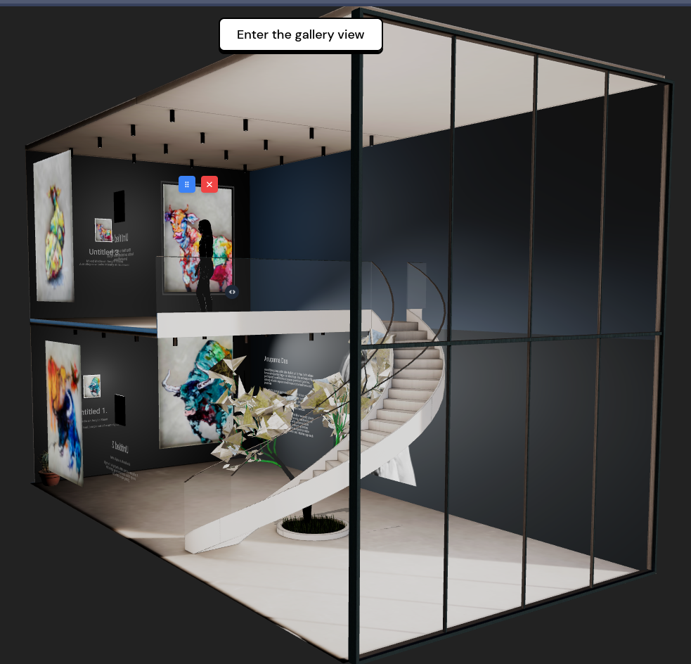
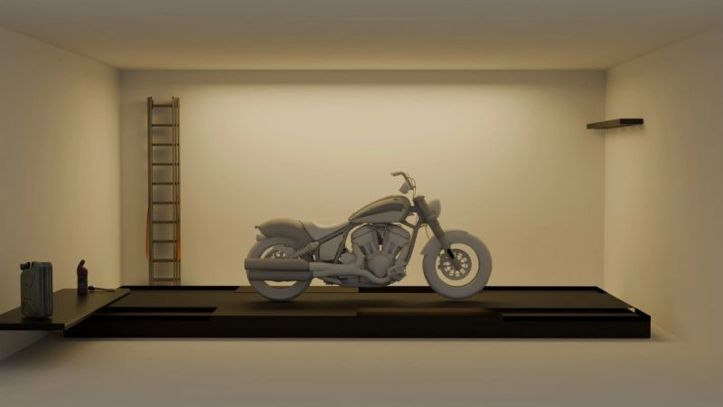
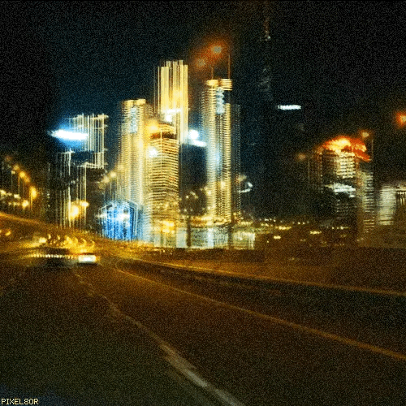
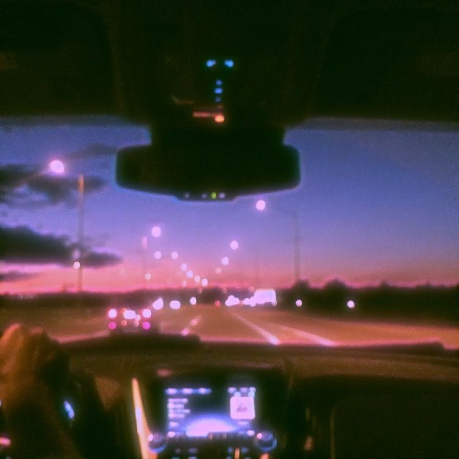
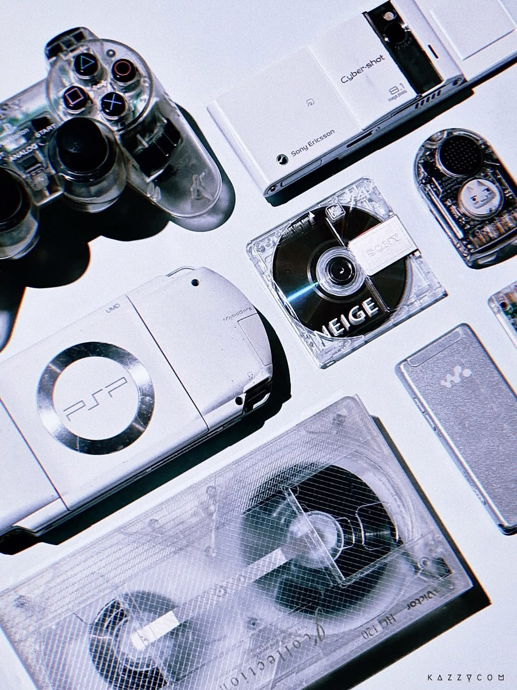
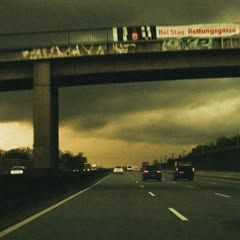
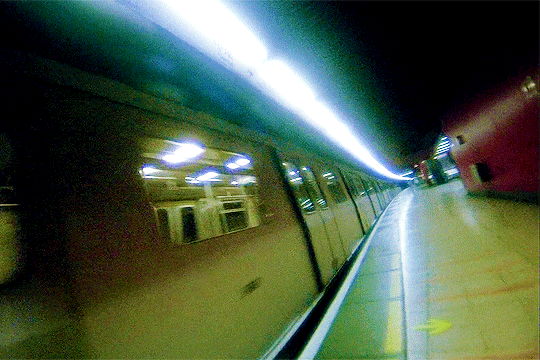

 

<h1>Dheer Jain</h1>

  <kbd>SOFTWARE ENGINEER</kbd>
  <kbd>INTERACTIVE 3D</kbd>
  <kbd>CREATIVE TECHNOLOGY</kbd>

  <em>software, visuals, music, motion - immersive worlds aren't built just by code</em>

  <a href="https://www.dheerjain.me/">↗ website</a>&nbsp;&nbsp;·&nbsp;&nbsp;
  <a href="https://devlog-dheer.hashnode.dev">↗ devlog</a>&nbsp;&nbsp;·&nbsp;&nbsp;
  <a href="https://www.linkedin.com/in/dheer-jain/">↗ linkedin</a>&nbsp;&nbsp;·&nbsp;&nbsp;
  <a href="https://github.com/calcifer-3118?tab=repositories">↗ repositories</a>

 

<!-- ========================================================= -->

<!-- 01 — PERSONAL / AESTHETIC                                -->

<!-- ========================================================= -->

<h2>✦ a little about me</h2>

<table>
<tr>
<td valign="top" width="58%">
I like building software that feels more like a world than a webpage.

Most of my work sits around creative development, real-time graphics and the web. I move between Three.js scenes, React interfaces, shaders, motion systems and game-like mechanics.

Right now I'm spending most of my time around Three.js · React · GLSL · GSAP · WebXR · Unity.
</td>
<td valign="top" width="42%">
CURRENTLY

- building immersive tools
- polishing interfaces
- exploring realtime graphics
- shipping experiments

</td>
</tr>
</table>

 

<!-- ========================================================= -->

<!-- 03 — WORK                                                 -->

<!-- ========================================================= -->

<h2>✦ things i've been building</h2>

<table width="100%">
<tr>

<!-- EQUAL ART -->

<td width="50%" valign="top">

 

<strong>01 / Equal Art</strong>

A digital art gallery built around spatial exploration - 3D exhibition environment with custom tools behind the scenes.

<kbd>THREE.JS</kbd>
<kbd>REACT</kbd>
<kbd>FULL-STACK</kbd>

 

<a href="https://shogambo.com/preview/aece6f0a-1b10-4e56-9f47-20e745e660d5">
  explore the gallery →
</a>

</td>

<!-- NEURAL WORKSPACE -->

<td width="50%" valign="top">

  

<strong>02 / Neural Workspace</strong>

A walkable portfolio disguised as a small digital world.

Third-person movement, bots, drones, terminals, multiple camera systems, portals, custom shaders and dynamically loaded projects.

<kbd>THREE.JS</kbd>
<kbd>REACT</kbd>
<kbd>GLSL</kbd>

 

<a href="https://www.neural-workspace.com/">
  enter the workspace →
</a>

</td>

</tr>

<tr>

<!-- VIRTUAL WRENCH -->

<td width="50%" valign="top">
  

 

<strong>03 / Virtual Wrench</strong>

A 3D motorcycle customization tool built around the idea that changing a machine should feel as tactile as changing one in a real garage.

Interactive parts, camera systems, modular components and real-time visualization.

<kbd>THREE.JS</kbd>
<kbd>WEBGL</kbd>
<kbd>3D PRODUCT</kbd>

 

<a href="https://github.com/calcifer-3118/Virtual-Wrench">
  open project →
</a>

</td>

<!-- OUTREALM -->

<td width="50%" valign="top">

 

<strong>04 / Outrealm</strong>

What if different websites could behave like different rooms inside the same world?

A lightweight system for moving between independent 3D web experiences while carrying player state across the transition.

<kbd>JAVASCRIPT</kbd>
<kbd>THREE.JS</kbd>
<kbd>SYSTEMS</kbd>

 

<a href="https://github.com/calcifer-3118/Outrealm">
  view project →
</a>

</td>

<td width="50%" valign="middle" align="center">

 

</tr>

<tr>
<td width="50%" valign="top">
  

<strong>MORE TO COME</strong>
 

 

<em>
there's usually another idea somewhere in the folder.
</em>

 

<a href="https://github.com/calcifer-3118?tab=repositories">
  <kbd>OPEN REPOSITORIES ↗</kbd>
</a>

</td>

</tr>
</table>

 

<h2>✦ the archive</h2>

<table>
<tr>
<td width="50%" valign="top">

<strong>GRAPHICS</strong> 
GLSL experiments · shaders · post-processing · particles · WebGL

</td>
<td width="50%" valign="top">

<strong>GAME SYSTEMS</strong> 
physics · cameras · controllers · NPCs · interaction systems

</td>
</tr>

<tr>
<td width="50%" valign="top">

<strong>IMMERSIVE</strong> 
WebXR · Unity · spatial interfaces · experimental worlds

</td>
<td width="50%" valign="top">

<strong>SMALL THINGS</strong> 
UI experiments · motion studies · prototypes · abandoned ideas

</td>
</tr>
</table>

 

  <a href="https://github.com/calcifer-3118?tab=repositories">
    <kbd>OPEN THE ARCHIVE ↗</kbd>
  </a>

<!-- ========================================================= -->

<!-- 05 — TOOLKIT                                               -->

<!-- ========================================================= -->

<h2>✦ the toolbox</h2>

  

  <kbd>JAVASCRIPT</kbd>
  <kbd>TYPESCRIPT</kbd>
  <kbd>THREE.JS</kbd>
  <kbd>REACT</kbd>
  <kbd>WEBGL</kbd>
  <kbd>GLSL</kbd>
  <kbd>GSAP</kbd>
  <kbd>UNITY</kbd>
  <kbd>WEBXR</kbd>

  
    also working with Node.js · PostgreSQL · Supabase · Prisma · Blender · C++ · Unreal Engine
  

<!-- ========================================================= -->

<!-- 02 — IMAGE / MOODBOARD                                   -->

<!-- ========================================================= -->

<h2>✦ after hours</h2>

  
  
  

  
  
  

 

<!-- ========================================================= -->

<!-- 04 — MUSIC                                                 -->

<!-- ========================================================= -->
<!-- 

 -->

 

> “Immersive worlds aren’t crafted with code alone, they’re shaped by the emotions they awaken.” ~Calcifer

 

  built by human&nbsp;&nbsp;·&nbsp;&nbsp;music in the background&nbsp;&nbsp;·&nbsp;&nbsp;calcifer-3118

